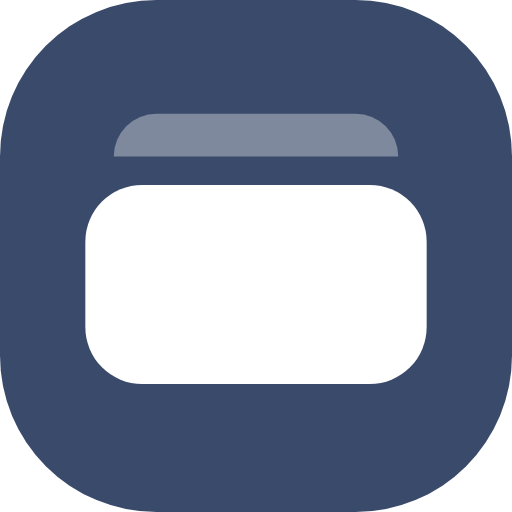
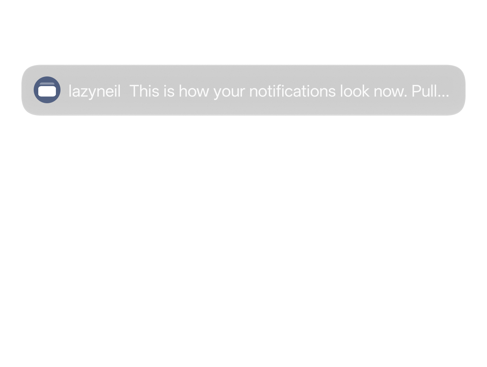
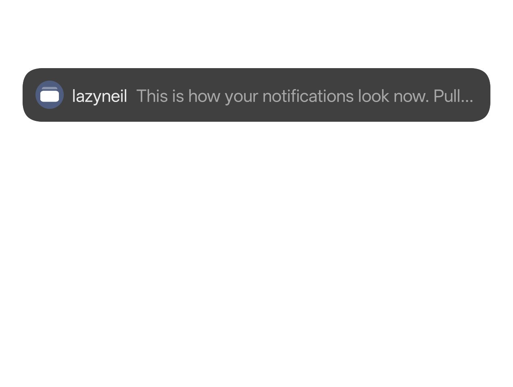
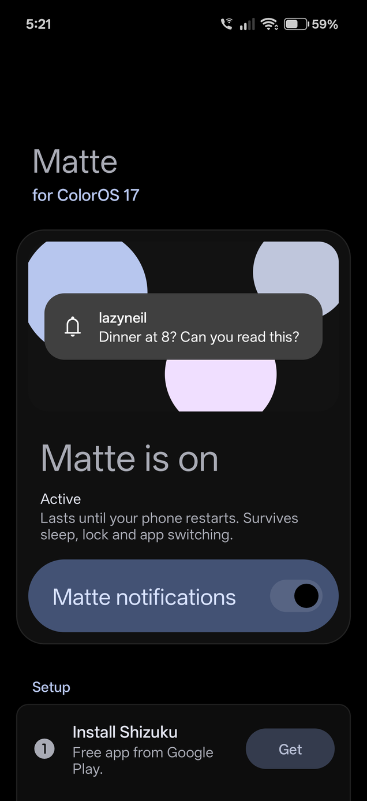
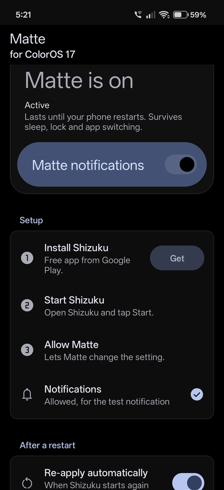
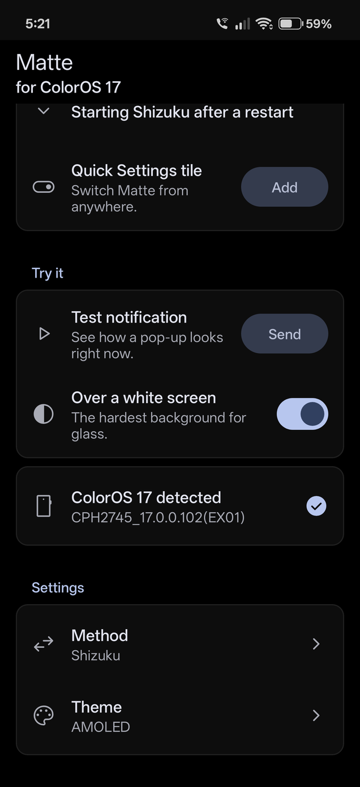
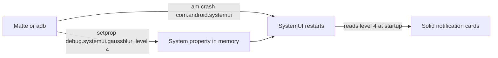

<div align="center">



<h1>Matte</h1>

<p><b>Solid, readable notification cards for ColorOS 17. One tap, no root, fully reversible.</b></p>

<a href="https://github.com/nathanrodrigues2111/matte/releases/latest"></a>
<a href="https://github.com/nathanrodrigues2111/matte/releases"></a>


<a href="LICENSE"></a>

<p>
<a href="https://nathanrodrigues2111.github.io/matte/"><b>Website</b></a> &nbsp;·&nbsp;
<a href="https://github.com/nathanrodrigues2111/matte/releases/latest"><b>Download APK</b></a> &nbsp;·&nbsp;
<a href="#how-it-works"><b>How it works</b></a>
</p>

</div>

## Before and after

| ColorOS 17 glass | Matte |
| :---: | :---: |
|  |  |

Real screenshots from a OnePlus 15 on ColorOS 17.0.0.102.

## Screenshots

<p align="center">



</p>

## Why

ColorOS 17 draws heads-up banners and shade cards as light grey frosted glass with white text. Over light apps they are close to unreadable, and no setting fixes it. Matte makes the cards solid: `#404040` in dark mode, `#fafafa` in light mode.

## Quick start

**On the phone, with Shizuku (recommended)**

1. Install and start [Shizuku](https://shizuku.rikka.app/).
2. Install Matte from [Releases](https://github.com/nathanrodrigues2111/matte/releases/latest) and allow Shizuku access.
3. Switch Matte on, or add the Matte tile to Quick Settings.

Matte turns itself back on after a reboot once Shizuku is running.

**From a computer, with adb**

```sh
adb shell setprop debug.systemui.gaussblur_level 4 && adb shell am crash com.android.systemui    # on
adb shell setprop debug.systemui.gaussblur_level -1 && adb shell am crash com.android.systemui   # off
```

Or use `scripts/matte.sh` (macOS, Linux) or `scripts\matte.bat` (Windows) with `on`, `off` or `status`.

## How it works

ColorOS 17 picks a blur level for SystemUI (the status bar, notification shade and heads-up banners) based on how powerful the phone is. High-end phones get the frosted glass. Low-end phones get level `4`, which skips blur and paints notification cards solid. Matte asks SystemUI to use that low-end look on your phone.



1. **Set the override.** SystemUI checks a debug property, `debug.systemui.gaussblur_level`, before its normal blur level. Android lets the shell user (adb, or Shizuku acting as adb) set any `debug.*` property, so no root is needed.
2. **Restart SystemUI.** SystemUI only reads the level when it starts, so Matte restarts it. The screen flickers for a few seconds and Android brings SystemUI straight back.
3. **Solid cards.** With level `4`, banners and shade cards are painted solid: `#404040` in dark mode, `#fafafa` in light mode, with full-contrast text.

Turning Matte off sets the property back to `-1` (no override) and restarts SystemUI again.

Nothing is installed into the system and no files change. The value lives in memory only, so a phone restart clears it. That is also why Matte needs to re-apply after every reboot.

The level logic lives in SystemUI's `ScrimUtil`, found by decompiling SystemUI on a OnePlus 15 running ColorOS 17.0.0.102.

<details>
<summary><b>Why not something else?</b></summary>

- **Overlays:** fabricated overlays are blocked for the shell on Android 16 (`Non-root shell cannot fabricate overlays`).
- **Custom themes:** the theme engine does not load SystemUI colors for these cards.
- **Root + LSPosed:** the [SANWU5/c17-statusbar](https://github.com/SANWU5/c17-statusbar) module works, but needs root.

</details>

## FAQ

<details>
<summary><b>Does it survive a restart?</b></summary>

No. Sleep, lock and SystemUI restarts are fine, a full phone restart resets it. With Shizuku, Matte re-applies it once Shizuku runs. With adb, run the command again.
</details>

<details>
<summary><b>Is it safe?</b></summary>

It sets one debug property SystemUI already supports and restarts the status bar. No root, no system files touched, fully reversible.
</details>

<details>
<summary><b>How do I undo it?</b></summary>

Switch it off in Matte, run the off command, or restart the phone.
</details>

<details>
<summary><b>Any side effects?</b></summary>

Other SystemUI blur goes flat too: shade background, Quick Settings, volume panel. The status bar flickers for a few seconds while switching.
</details>

<details>
<summary><b>Which phones?</b></summary>

ColorOS 17 on OnePlus, OPPO and realme. Other versions are untested.
</details>

## Disclaimer

Not affiliated with, endorsed by, or sponsored by OPPO, OnePlus or realme. Use at your own risk.

## License

[MIT](LICENSE)
